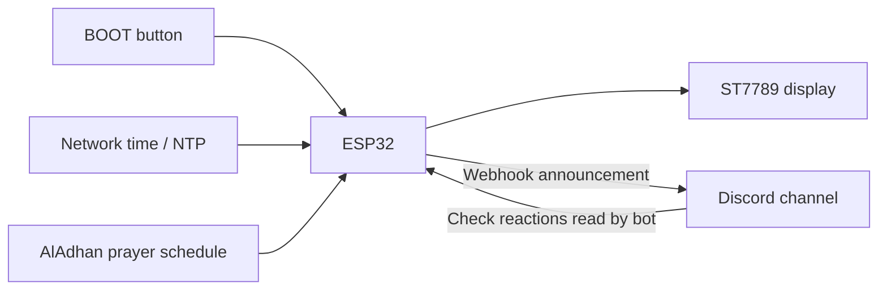

# Jama'ah Beacon

**Bring your campus together for prayer with one press.**

Jama'ah Beacon is an ESP32 device that connects a physical prayer space to a
Discord community. Select a prayer and a wait time, then press the onboard
button to announce that a congregation is forming. Students can RSVP with a
green check reaction, while the device shows the countdown and joining count.

Built by **Emron Arsala** as a solo project, Jama'ah Beacon placed **2nd overall
at the MTC x Replit x Manara West Buildathon** and is used by students at the
UC San Diego prayer space.

**[Project story and demo on Devpost](https://devpost.com/software/jamaah-beacon)**

## Features

- One-button control using the ESP32's built-in **BOOT** button.
- Five prayers: Fajr, Dhuhr, Asr, Maghrib, and Isha.
- Automatic prayer selection from a daily schedule, with manual override.
- Selectable **2-, 5-, and 10-minute** congregation waits.
- Landscape ST7789 display with the selected prayer, countdown, RSVP count,
  clock, and connection status.
- Discord announcements, an automatic bot check reaction, and RSVP polling.
- Wi-Fi reconnection and a countdown that continues through connection loss.
- Automatic interface reset after each congregation countdown.
- Dry-run mode for testing without posting to Discord.
- HTTPS certificate verification using the ESP32's built-in trusted CA bundle.

## How it works



The **webhook** posts the announcement. The **bot** adds the initial green check
and reads the message's reactions. The ESP32 makes these requests directly;
you do not need a separate Node.js or Python bot server.

Network requests run in a separate FreeRTOS task so slow HTTPS requests do not
block the main display and button loop. The active prayer and wait time are
captured when an announcement starts and stay fixed during that countdown.

## Hardware

The current sketch targets:

- A **classic ESP32 development board** with a BOOT button on GPIO 0.
- A **240 x 320 ST7789 SPI TFT display**, used in 320 x 240 landscape mode.
- A USB data cable and suitable power supply.
- Jumper wires and, optionally, a breadboard.
- A 2.4 GHz Wi-Fi network for live operation.

No additional button is required. Other ESP32 variants and display resolutions
may need different pins or layout changes.

### Wiring

| Display signal | ESP32 connection |
| --- | --- |
| SCK / SCL / CLK | GPIO 18 |
| MOSI / SDA / DIN | GPIO 26 |
| CS | GPIO 16 |
| DC / A0 | GPIO 17 |
| RST / RES | GPIO 21 |
| GND | GND |
| VCC / VIN | Supply specified by your display breakout |
| BL / LED | Follow the display breakout's backlight instructions |

Some SPI displays label their clock/data pins **SCL** and **SDA**. In this
project those are SPI signals, not I2C. MISO is not used.

Use a display compatible with **3.3 V logic** and a common ground. Supply-voltage
and backlight requirements vary by breakout; check its documentation rather
than assuming every ST7789 board has the same power circuit. The sketch does
not control a separate backlight GPIO.

The display initialization is:

```cpp
SPI.begin(TFT_SCK, -1, TFT_MOSI, TFT_CS);
tft.init(240, 320);
tft.setRotation(1);
```

## Software requirements

Install Arduino IDE and the **esp32 by Espressif Systems** board package.
If that package is not listed, add Espressif's stable index to **Additional
Boards Manager URLs** in Arduino IDE's preferences:

```text
https://espressif.github.io/arduino-esp32/package_esp32_index.json
```

Then open Boards Manager, search for `esp32`, and install the package published
by Espressif Systems. See the [official installation instructions](https://docs.espressif.com/projects/arduino-esp32/en/latest/installing.html).

Use **version 3.3.12** as the reference version for this project. The sketch
rejects older versions because it uses the built-in CA bundle API. Newer 3.x
versions may work but should be checked with your board.

Install these through Arduino IDE's Library Manager:

| Library | Reference version |
| --- | --- |
| ArduinoJson | 7.4.3; use the 7.x API |
| Adafruit GFX Library | 1.13.0 |
| Adafruit ST7735 and ST7789 Library | 1.12.0 |
| Adafruit BusIO | 1.17.4 |

Wi-Fi, HTTPS, SPI, time synchronization, and FreeRTOS support come from the
ESP32 board package.

## Quick start: test without Discord

1. Download or clone this repository and open `JamaahBeacon.ino` in Arduino IDE.
   If prompted, let the IDE place it in a folder named `JamaahBeacon`.
2. Connect the display using the wiring above.
3. Select **ESP32 Dev Module** for a compatible classic ESP32 board and choose
   its serial port.
4. Set the following flags near the top of the sketch:

   ```cpp
   constexpr bool DRY_RUN = true;
   constexpr bool FAST_DRY_RUN = true;
   ```

5. Upload, then open Serial Monitor at **115200 baud**.

**Set these flags explicitly before testing.** The current sketch's configuration
selects live mode; the instructions above switch it into a fast demo.

In dry-run mode, no Discord requests are made and no Discord credentials are
needed. Wi-Fi is optional for the button/countdown demo. If valid Wi-Fi settings
are supplied, network time and prayer-schedule fetching can still operate.

With fast dry run enabled, each selected minute lasts **one second**:

| Selected wait | Fast-demo countdown | Live countdown |
| --- | --- | --- |
| 2 minutes | 2 seconds | 2 minutes |
| 5 minutes | 5 seconds | 5 minutes |
| 10 minutes | 10 seconds | 10 minutes |

The display identifies the fast demo. Setting `DRY_RUN = false` always restores
full-minute waits, regardless of `FAST_DRY_RUN`.

## Button controls

All actions happen **when BOOT is released**, after debouncing.

| Hold duration while ready | Action on release |
| --- | --- |
| Less than 1 second | Announce the selected congregation |
| At least 1 second, but less than 3 seconds | Select the next prayer |
| 3 seconds or longer | Select the next wait time |

- Prayer order: **Fajr → Dhuhr → Asr → Maghrib → Isha → Fajr**.
- Wait order: **2 → 5 → 10 → 2 minutes**.
- The initial wait is **5 minutes**, so the first long hold selects **10**.
- A long hold does not also change the prayer or repeat while held down.
- Manual prayer selection remains active until the congregation interface resets.
- Controls are locked while sending and counting down.

At zero, the screen shows `STARTING!`. It returns to the ready screen after
**15 seconds**. A BOOT gesture can clear that screen early, without sending
another announcement. The chosen wait is retained between sessions; restarting
the device restores the five-minute default.

Let the board finish booting before using these controls. Holding GPIO 0 low
during reset selects the ESP32 serial bootloader instead of normal execution.
[ESP32 boot-mode documentation](https://docs.espressif.com/projects/esptool/en/latest/esp32/advanced-topics/boot-mode-selection.html).

## Discord setup

You need a server/channel where you can create a webhook and install a bot.
For the first live test, use a regular text channel.

### 1. Create a channel webhook

Create an incoming webhook for the channel that should receive congregation
announcements. Copy its complete URL and enter it locally:

```cpp
const char* DISCORD_WEBHOOK =
  "https://discord.com/api/webhooks/YOUR_WEBHOOK_ID/YOUR_WEBHOOK_TOKEN";
```

Use the plain URL with **no query string or trailing slash**. The sketch adds
`?wait=true` so Discord returns the created message's identifiers.
[Discord webhook reference](https://docs.discord.com/developers/resources/webhook).

### 2. Create and install a bot

1. Create an application in the [Discord Developer Portal](https://discord.com/developers/applications).
2. Configure its bot and obtain the **bot token**.
3. Generate a server installation link with the `bot` scope and install the
   bot in the same server as the webhook.
4. Give the bot these permissions in the webhook's channel:
   - **View Channel**
   - **Read Message History**
   - **Add Reactions**
5. Check channel-specific permission overrides as well as the bot's server role.

Administrator permission is unnecessary. The sketch reads reaction fields
through the REST API; it does not require Message Content intent.
[Discord message and reaction permissions](https://docs.discord.com/developers/resources/message).

Enter the token locally:

```cpp
const char* DISCORD_BOT_TOKEN = "YOUR_DISCORD_BOT_TOKEN";
```

Use the **bot token**, not the application ID, public key, or client secret.
Do not add `Bot ` at the beginning; the sketch adds that authorization prefix.
Both the webhook URL and bot token must be configured before live announcements.

### 3. Add Wi-Fi and switch to live mode

```cpp
constexpr bool DRY_RUN = false;
constexpr bool FAST_DRY_RUN = false;

const char* WIFI_SSID = "YOUR_WIFI_SSID";
const char* WIFI_PASSWORD = "YOUR_WIFI_PASSWORD";
const char* LOCATION_NAME = "Your prayer space";
```

Use `""` for the password only if your network is open. The current UCSD network
and location values are deployment-specific; replace them for your own space.
`LOCATION_NAME` is the text used in Discord announcements, not a location sensor.

Upload again. Wait for Wi-Fi and the NTP clock to synchronize before announcing.
The sketch does not sign into browser-based captive portals. If a guest network
connects but blocks internet access, try an ordinary 2.4 GHz hotspot.

## Configure prayer times for your location

The current configuration uses the UCSD area, Pacific time, ISNA calculation
method 2, and **standard non-Hanafi Asr**:

```cpp
constexpr double LATITUDE = 32.8810;
constexpr double LONGITUDE = -117.2340;
constexpr int CALCULATION_METHOD = 2;
constexpr int ASR_SCHOOL = 0; // 0 = standard; 1 = Hanafi

const char* TIMEZONE = "PST8PDT,M3.2.0,M11.1.0";
const char* API_TIMEZONE = "America/Los_Angeles";
const char* API_TIMEZONE_ENCODED = "America%2FLos_Angeles";
```

Change the coordinates and method to suit your community. When changing time
zones, update all three time-zone values consistently: the local POSIX rule,
the API's IANA name, and its URL-encoded form. Changing the clock's local
time-zone rule alone does not change the API request.

Prayer times come from the [AlAdhan API](https://aladhan.com/prayer-times-api).
Compare calculated times with your local prayer-space schedule.

### Automatic selection policy

The sketch selects a prayer for convenience; it does not automatically announce:

| Local time | Automatically selected prayer |
| --- | --- |
| Before Fajr | Isha from the previous night |
| Fajr until sunrise | Fajr |
| Sunrise until Dhuhr | Dhuhr, the upcoming prayer |
| Dhuhr until Asr | Dhuhr |
| Asr until Maghrib | Asr |
| Maghrib until Isha | Maghrib |
| Isha onward | Isha |

The schedule refreshes after the local date changes. Failed fetches retry no
more than once a minute while idle. If the schedule is unavailable, you can
select a prayer manually; live HTTPS sends still require a synchronized clock.
With no schedule loaded, the initial fallback selection is Asr.

## RSVP behavior

After Discord confirms an announcement, the local countdown starts and the bot
adds a normal ✅ reaction. The device polls the message for changes, normally
waiting five seconds between successful polls; network delays and rate limits
can make updates slower.

- The bot's own initial reaction is excluded from `Joining`.
- Adding or removing a normal ✅ updates the count after a successful poll.
- Super reactions are omitted to avoid counting normal and super reactions twice.
- Other accounts, including other bots, can contribute normal checks.
- The count represents reaction-based RSVPs, not verified attendance or names.
- A failed poll keeps the last count and marks it unconfirmed until a successful
  update. The local countdown continues through Wi-Fi loss.

## Test checklist

### Fast demo: no Discord messages

With `DRY_RUN = true` and `FAST_DRY_RUN = true`:

1. Hold BOOT for about **1.5 seconds** and release. Only the prayer changes.
2. Hold for about **3.5 seconds** and release. Only the wait changes.
3. Hold for six seconds once. It should still advance only one step, on release.
4. Select 10 minutes and tap. Expect a 10-second demo countdown and the proposed
   announcement text in Serial Monitor, without an actual Discord post.
5. During the countdown, send `++` through Serial Monitor. `Joining` becomes 2.
   Send `-` to reduce it to 1. These inputs simulate RSVPs only in dry-run mode.
6. Try holding BOOT during the countdown. The announced settings remain locked.
7. Let the timer reach zero. Confirm `STARTING!`, then an automatic reset after
   15 seconds. The chosen wait should remain selected.

Set `FAST_DRY_RUN = false` to test full-duration timers without posting.

### Live test

With your credentials configured and `DRY_RUN = false`:

1. Select a suitable prayer and a two-minute wait, then tap.
2. Confirm one Discord post with the selected prayer, location, and wait.
3. Confirm the bot's check reaction appears while `Joining` stays at 0.
4. Add a normal check from your own account, then remove it. Confirm the count
   rises and falls after successful polls.
5. Briefly interrupt Wi-Fi. The countdown should continue and the joining count
   should become unconfirmed. Restore Wi-Fi and check reconnection/polling.
6. Confirm the interface resets after the countdown and can start a fresh session.

## Troubleshooting

| Symptom | What to check |
| --- | --- |
| `DEMO` appears or the timer finishes in seconds | Check `DRY_RUN` and `FAST_DRY_RUN`. Set `DRY_RUN = false` for actual Discord messages and full-minute waits. |
| `SETUP` or a credential reminder | Replace both Discord placeholders. Check the webhook format and ensure the bot token has no `Bot ` prefix. |
| `NO WIFI` | Check the SSID, password, 2.4 GHz network, and signal. A connected guest network may still require a captive-portal login. |
| `NTP...` | Wait for time synchronization and check internet/NTP access. The clock must be valid before verified HTTPS sends. |
| `Network busy` notice | A background request is running. Wait briefly and tap again; no announcement is queued for later. |
| `WEBHOOK ERR`, HTTP 401/403/404 on a send | Check or replace the webhook and verify channel access. Fix the configuration and restart. |
| Announcement posts but check/RSVP fails | Verify the bot token, server installation, channel permissions, and permission overrides. Restart after correcting authentication/access errors. |
| `Joining` is unconfirmed | The count has not been refreshed successfully. Check connectivity and the Serial Monitor status codes. |
| HTTP 429 / rate-limit notice | Allow the requested backoff period. Do not repeatedly tap or reset to bypass it. |
| `CHECK CHAT` | The send response was ambiguous. Inspect Discord first. One fresh BOOT gesture clears the screen without sending; a separate tap is needed to try again. |
| Blank or incorrect display | Check power, common ground, SPI pin mapping, and display dimensions. Backlight power is module-specific. |
| Board enters upload mode on reset | Release BOOT during normal startup. GPIO 0 is a boot-strapping pin. |

Serial Monitor runs at **115200 baud**. Network logs identify operations as:
`0` announcement, `1` bot reaction, `2` RSVP read, and `3` prayer schedule.

## Credentials and public repositories

**Commit placeholders, not real credentials.** A webhook URL contains a secret
token, just like the bot token. Keep both, and any private Wi-Fi password, out
of commits, screenshots, Serial Monitor captures, and issue reports.

The current sketch stores settings directly in the `.ino` file. It does not
automatically load a `secrets.h` file or environment variables. Check your diff
before pushing any locally configured copy. If you later move credentials into
a separate file, update the sketch accordingly and exclude that file from Git.

If a real token or webhook is exposed, revoke/reset it in Discord and update
your device. Deleting it from the latest commit does not invalidate the secret
or remove it from existing Git history.

## Implementation notes and current limits

- HTTPS uses the ESP32's trusted CA bundle rather than disabling certificate
  verification. Keep the board package current as certificate trust stores evolve.
- The webhook POST is not automatically retried. A lost response might follow
  a successful post, so `CHECK CHAT` asks you to inspect Discord first.
- Discord rate limits pause requests according to response timing information.
- Bot authentication/permission failures stop further bot requests until restart.
  A deleted message stops RSVP polling for that congregation only.
- The announcement is not edited or deleted when the countdown finishes.
- Wait settings, manual override, and the active session are stored in RAM.
  Power cycling loses the session and restores the default wait; it does not
  recover or repost an earlier announcement.
- The current design handles one active congregation per device and one
  configured Discord destination. There is no multi-device coordination or
  central dashboard.

## Contributing

Bug reports and improvements are welcome. Include your board, display model,
ESP32 core/library versions, reproduction steps, and relevant status codes.
Remove all credentials before sharing code or logs.

Possible improvements include an enclosure, easier network provisioning,
persistent preferences, and coordination across multiple prayer spaces.

## Acknowledgments

Built with the ESP32 Arduino core, Adafruit GFX/ST7789 libraries, ArduinoJson,
AlAdhan prayer-time data, and Discord's webhook and bot APIs.

- [Espressif verified HTTPS example](https://github.com/espressif/arduino-esp32/blob/3.3.12/libraries/NetworkClientSecure/examples/WiFiClientSecureBuiltinCACertBundle/WiFiClientSecureBuiltinCACertBundle.ino)
- [Discord Developer documentation](https://docs.discord.com/developers/intro)
- [AlAdhan prayer-times API](https://aladhan.com/prayer-times-api)
- [Project demo and story](https://devpost.com/software/jamaah-beacon)
